# 01 — Annotate, Train, Test, and Run ROI Analyzer

**GRIME-AI pre-workshop system check — Missouri**

## Part A — Annotate one image in SAGE

1. In GRIME-AI, open **Tools → SAGE** (or launch `sage` from the activated Conda environment).

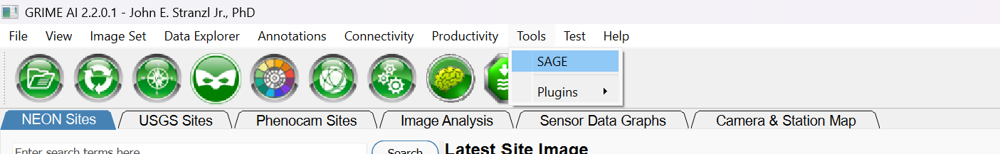

2. Use the image-folder selector in SAGE to open `04_participant_annotations/new_image/`.

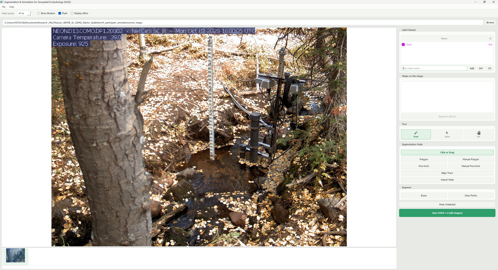

3. Select the image. Zoom in until the staff gage is clearly visible.
4. In the **Label Manager**, create a label by putting **`Staff`** in the `New label name` field and hit `Add` button. Preserve this exact spelling to match the supplied model-training annotations.

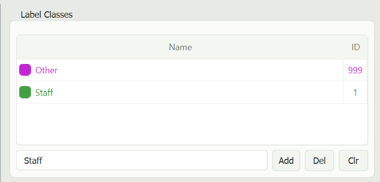

5. In the `Label Class` panel, click `Staff` to select it as the annotation class. Next, navigate to the `Segmentation Mode` panel and select the `Manual Polygon` tool. Click around the visible outline of the staff gage to place vertices along its edges. Once the entire staff gage is outlined, right-click to finish drawing the polygon.

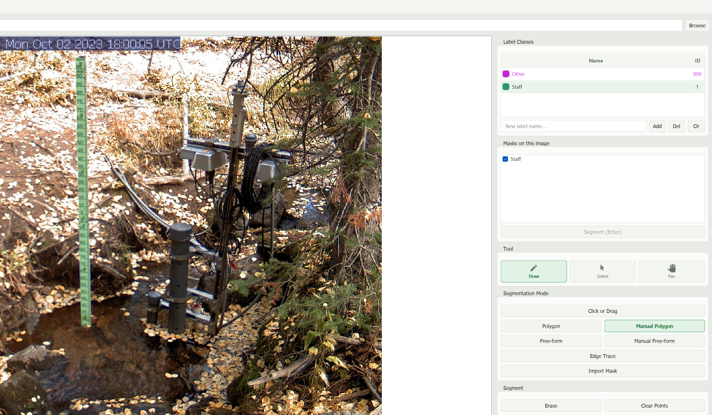

6. Inspect the colored mask overlay. The mask should cover the **gage**, not nearby water, banks, vegetation, shadows, or the mounting post unless part of the intended target.

7. Click **Save COCO 1.0 (All Images)**. Save to the participant annotation location offered by SAGE and note the output path shown in the confirmation dialog. Keep the original image with the exported annotation dataset; move/copy them together if needed.

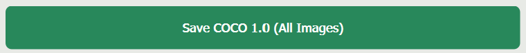

8. Check that the exported dataset contains a readable COCO `.json` file and that its listed image can still be located. Confirm SAGE reports at least **one image and one annotation** saved.

**PASS:** One image has a visually correct `Staff` mask and the COCO export completes successfully.

## Part B — Train a model with given datasets

1. Return to GRIME-AI. Open **Deep Learning→ Train Model** by clicking the Brain icon 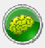

2. In the `Enter folder path` browser, select the parent directory containing both the supplied `01_training_COCO/` dataset and the newly annotated dataset in `04_participant_annotations/`. Once you select the parent directory, both folders, 01_training_COCO and 04_participant_annotations/new_image, will automatically appear in the Available Image Folders panel on the left.

3. Under Available Image Folders, double-click the `01_training_COCO` folder to move it to the Selected Image Folders panel on the right. Alternatively, select 01_training_COCO and click `Move to Right`. Make sure the training folder appears under Selected Image Folders before proceeding.

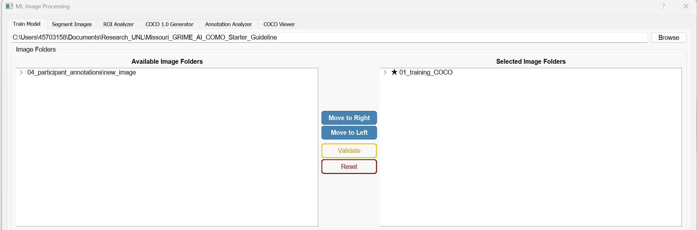

4. Click **Validate** to check the validity of the dataset.

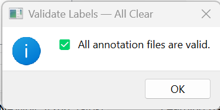

5. Under model architecture, select **SAM2**.
6. Under **Label Selection**, select **`Staff`**.
7. Set **Site Name** to something unique, for example `Missouri_Staff`.
8. For a short functionality test, set **Number of Epochs = 20**. Leave learning rate, optimizer, weight decay, and other advanced options at their defaults.
9. Click **Train** and monitor the training progress and application log. Wait for the run to finish successfully.

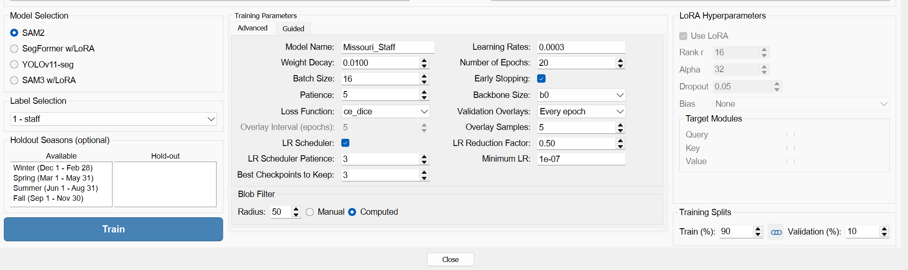

**PASS:** Dataset validation succeeds for both inputs, training finishes without an error and it is showing that model is saved in the terminal.

## Part C — Test the trained model on unseen images

1. Navigate to the **Segment Images** tab in the **Deep Learning** window. If you have closed the window, click the **Brain icon** to reopen it, just as you did for model training. If the window is still open, simply click the **Segment Images** tab located next to the **Train Model** tab at the top of the window.
2. Select **SAM2** as the model architecture.
3. Turn on **Save Predicted Masks**, **Save Probability Maps**, and **Save Diagnostic Panels**, if these options are available in your version.
4. Leave the **SAM2 Spatial Filter** at its recommended default, generally **Mahalanobis**, for this first test.
5. Under **Select Model → Browse**, navigate to the `03_models/` folder and select the pretrained model checkpoint named `best_1st_staff_epoch019_valloss0.1214_lr0.0001.torch`. Once selected, confirm that the model metadata loads correctly and displays the staff label in `Labels` panel.

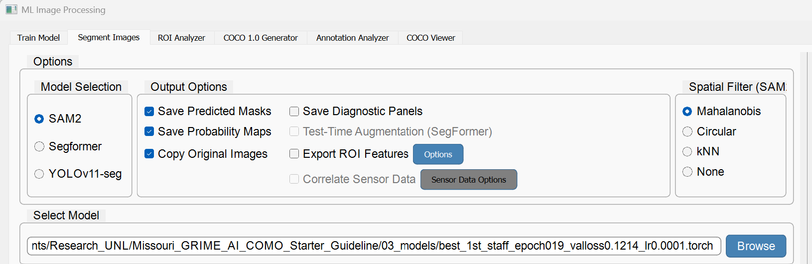

6. Set **Output Folder** to `05_outputs/test_inference/`.
7. Use **Add Folder** to select **only** `02_test_images/`. Do not add the training folder or the image newly annotated in Part A.

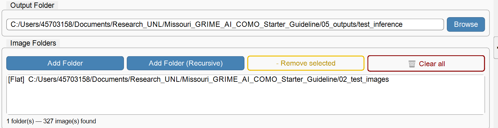

8. In **Labels**, select **`Staff`**.
9. Click **Segment Images**. Wait until processing is complete and check the application log for failures.

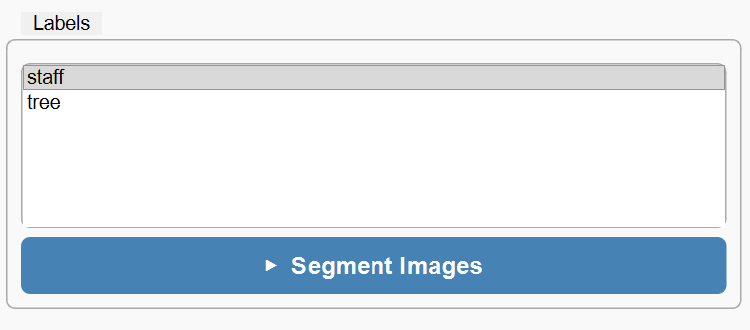

10. Open the output folder. Confirm files were created for the processed test images.

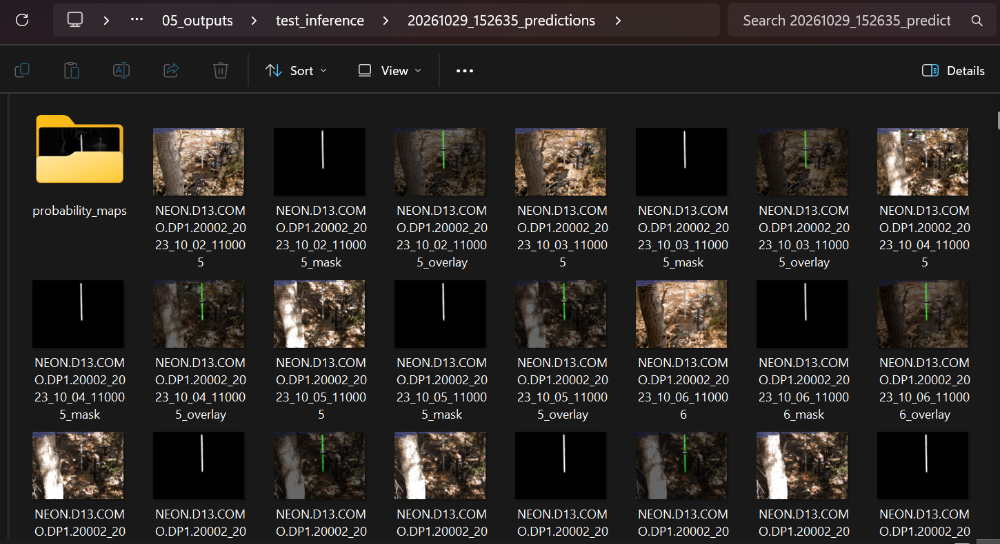

**PASS:** Inference completes on images excluded from training, output files are saved, and the predicted masks can be opened and inspected.

## Part D — Test ROI Analyzer

1. Navigate to the **ROI Analyzer** tab in the **Deep Learning** window, located next to the **Segment Images** tab. If you have closed the window, click the **Brain icon** in the main GRIME-AI interface to reopen it.

2. At the top of the **ROI Analyzer** tab, click **Browse** and navigate to `05_outputs/test_inference/`. Select the predictions folder generated during Part C (e.g., `20261029_152635_predictions`). The ROI Analyzer will load the segmentation results and display the images.

  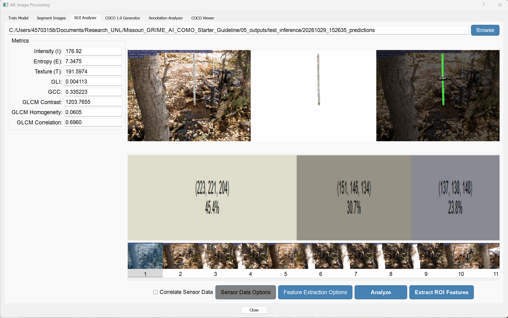

3. Review the displayed results. The **top-left panel** shows the original image, the **top-middle panel** shows the detected staff-gage region, and the **top-right panel** displays the segmentation prediction with the `STAFF` label. Confirm that the staff gage has been correctly identified.

4. Use the **image thumbnails** at the bottom to navigate between different images. Select atleast 3 images to verify that the model consistently detects the staff gage across the image collection.

5. Review the **Metrics** panel on the left, which displays calculated image features, including Intensity (I), Entropy (E), Texture (T), GLI, GCC, GLCM Contrast, GLCM Homogeneity, and GLCM Correlation. As you navigate between images, verify that the displayed metric values update accordingly to reflect the selected image.

7. Click **Analyze** to run the analysis using the selected settings. The process should complete quickly, and you may not notice any visible changes in the interface. Once the analysis is complete, click **Extract ROI Features** to calculate and export the ROI feature values.

  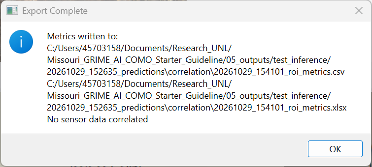

8. Review the generated results and confirm that the ROI feature values have been successfully calculated. Navigate to the predictions folder inside `05_outputs/test_inference/` and open the **correlation** subfolder. Verify that the ROI analysis results have been saved in both **CSV (.csv) and Excel (.xlsx)** formats. Open either file to confirm that it contains the calculated feature values for the processed images.

**PASS:** ROI Analyzer successfully loads the segmentation predictions, displays the detected staff-gage regions, allows navigation between images, calculates image features, and produces ROI analysis results.