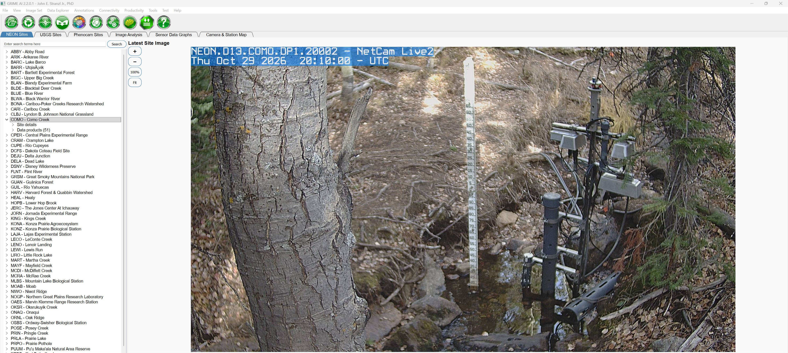
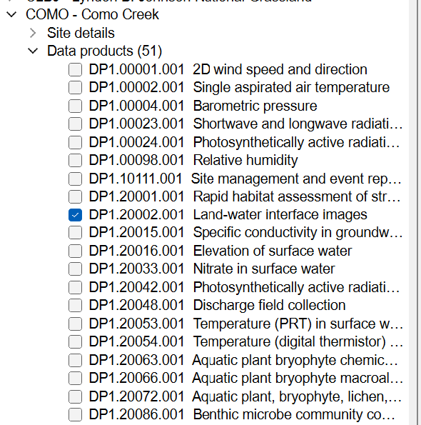
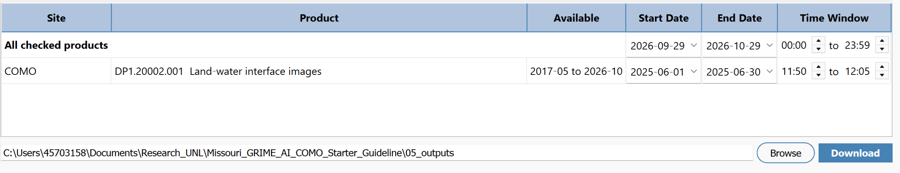
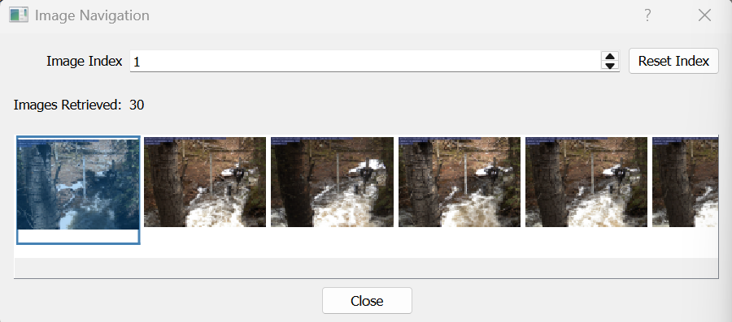
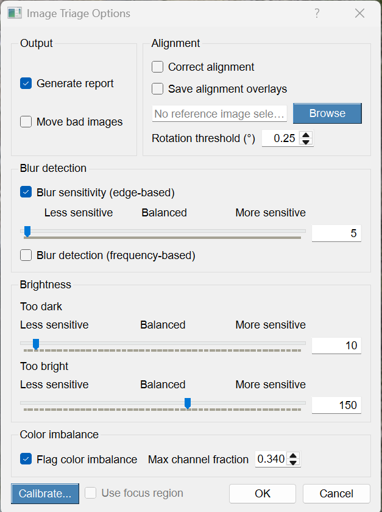
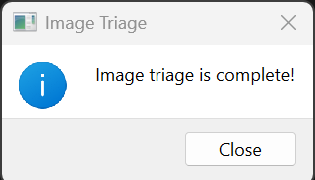
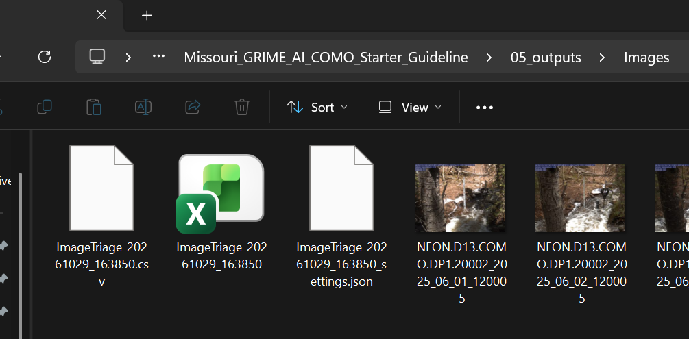
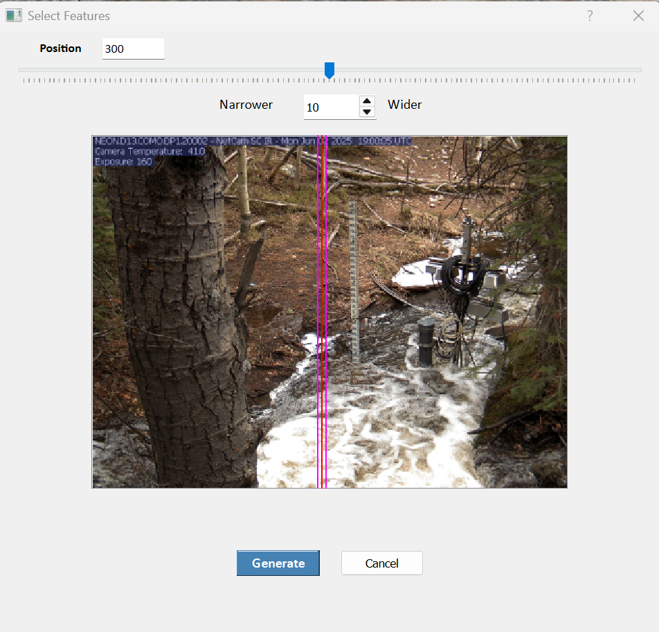

# 02 — Download, Triage, and Generate a Composite Slice Image

**GRIME-AI pre-workshop system check — Missouri**

## Part A — Download One Month of COMO Images

1. Start **GRIME-AI**. The **NEON Sites** tab should be visible by default in the main interface. If another tab is open, navigate to **NEON Sites**. In the left panel, locate and click **COMO - Como Creek**. After a few seconds, the latest available image from the site will appear in the Latest Site Image panel. The displayed image should look similar to the staff-gage images used in the model training dataset.

   

     
   

2. Under **COMO - Como Creek**, click the small arrow next to **Data products (51)** to expand the list of available data products. Locate **DP1.20002.001 — Land-water interface images** and check the box beside it to select the imagery product. Once selected, the product will appear in the table at the bottom of the GRIME-AI window.

   

     
   

3. In the bottom table, locate the row for **COMO — DP1.20002.001 Land-water interface images**. Under the **Start Date** and **End Date** columns, set the **Start Date** to `2025-06-01` and the **End Date** to `2025-06-30` to download one month of imagery. Make sure you are modifying the COMO product row rather than the **All checked products** row.

4. Under the **Time Window** column for the COMO product, set the time range to **11:50–12:05** to retrieve images captured around noon.

5. At the bottom-right corner of the window, click **Browse** to select the destination folder for the downloaded images. For this example, navigate to the repository and select `05_outputs/` as the output directory.

   

     
   

6. Once everything is configured, click **Download** in the bottom-right corner and wait for the download process to complete.

7. Navigate to `05_outputs/` and locate the newly downloaded COMO imagery folder. Open the folder and verify that the images were downloaded successfully.

**PASS:** The selected imagery product downloads successfully, and the downloaded images can be located and opened.

---

## Part B — Load Images and Run Image Triage

1. In the main **GRIME-AI** window, click the **Folder icon**  located at the top-left corner to open the **Data Exploration** window.

2. Under **Images Folder**, click **Browse** and navigate to the folder containing the downloaded images (e.g., `05_outputs/Images/`). Select the folder to load its path into the **Images Folder** field.

3. Click **Fetch Image List** to load the images from the selected directory. This will open a new **Image Navigation** window showing the retrieved images. Confirm that the images have loaded successfully.

   

     
   

4. Once the **Image Navigation** window is open, return to the **Data Exploration** window. If needed, move the **Image Navigation** window aside so you can access the buttons in **Data Exploration**. Then click **Image Triage**.

5. A confirmation window will appear with the message **"You are about to perform Image Triage. Would you like to continue?"**. Click **Yes** to proceed.

6. Another window will appear asking you to select the image folder. Navigate to `05_outputs/Images/`, which contains the images downloaded in the previous steps. Select this folder to continue.

7. Then the **Image Triage Options** window will open. Leave all settings at their default values, ensure **Generate report** is checked, and click **OK** to start the image triage process.

   

     
   

8. Wait for the image triage process to finish. When complete, a confirmation window will appear indicating that image triage is complete.

   

     
   

9. Navigate back to the selected downloaded image folder. Confirm that image triage generated three output files in that folder: a **CSV report**, an **Excel report**, and a **settings JSON** file.

   

     
   

**PASS:** The downloaded images load successfully, Image Triage completes without errors, and the selected folder contains the three generated output files.

---

## Part C — Generate a Composite Slice Image

1. Return to the **Data Exploration** window and click **Composite Slice**. This will open a new window titled **Select Features**, displaying a sample image from the selected image collection.

2. In the **Select Features** window, you will see a vertical highlighted slice overlaid on the image. This slice represents the portion of each image that will be extracted to generate the composite slice image.

   

     
   

3. Use the **Position** slider at the top of the window to move the vertical slice across the image. Try moving the slider left and right to verify that the slice position changes correctly.

4. Adjust the slice width using the **Narrower / Wider** control. Try increasing and decreasing the width to confirm that the highlighted slice becomes wider or narrower. You can also enter values manually in the corresponding fields.

5. Once you have confirmed that both controls are working, choose your preferred slice position and width, then click **Generate** to create the composite slice image.

6. Monitor the **GRIME-AI terminal**, which will display information about the composite generation process, including the number of images processed, the composite image width, and the location where the generated image is saved.

7. Look for the **Composite Filename** in the terminal output. This shows the full path to the generated composite image. Navigate to that location using File Explorer. For example, the output may be saved in:

   `C:\Users\<YourUsername>\Documents\GRIME-AI\composite_slices\`

8. Locate the generated **CompositeImage** `.jpg` file and open it to verify that the composite slice image was successfully created and can be viewed.

**PASS:** The **Position** slider and **Narrower / Wider** controls respond correctly, the composite slice image is generated without errors, and the saved image can be located and opened successfully.
